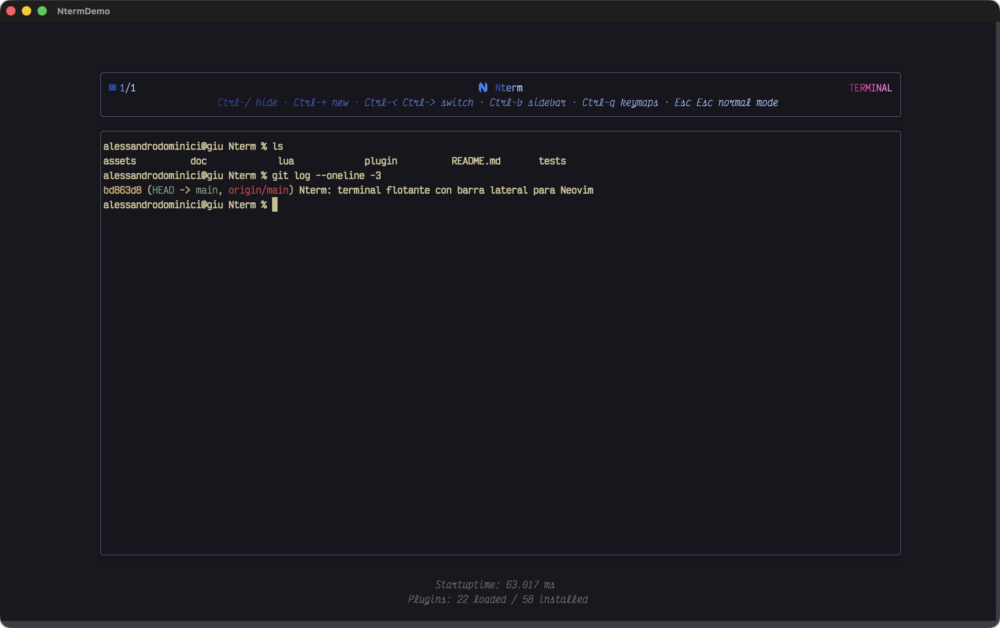
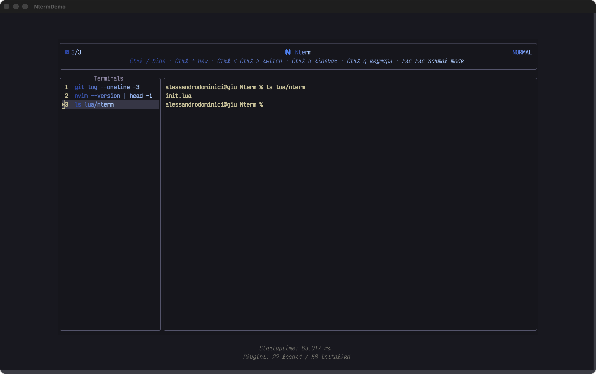
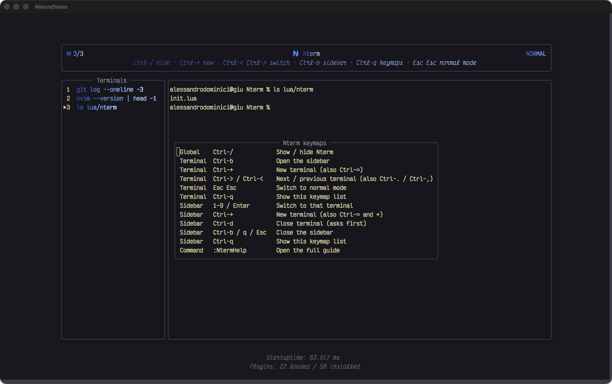
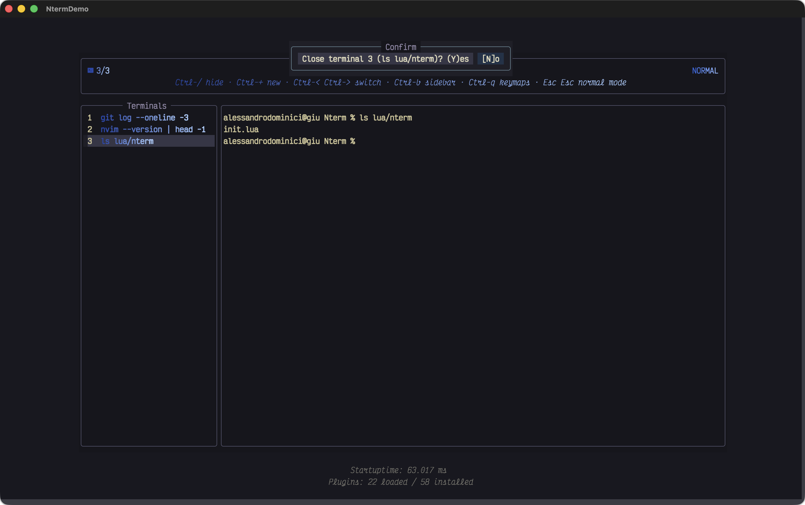
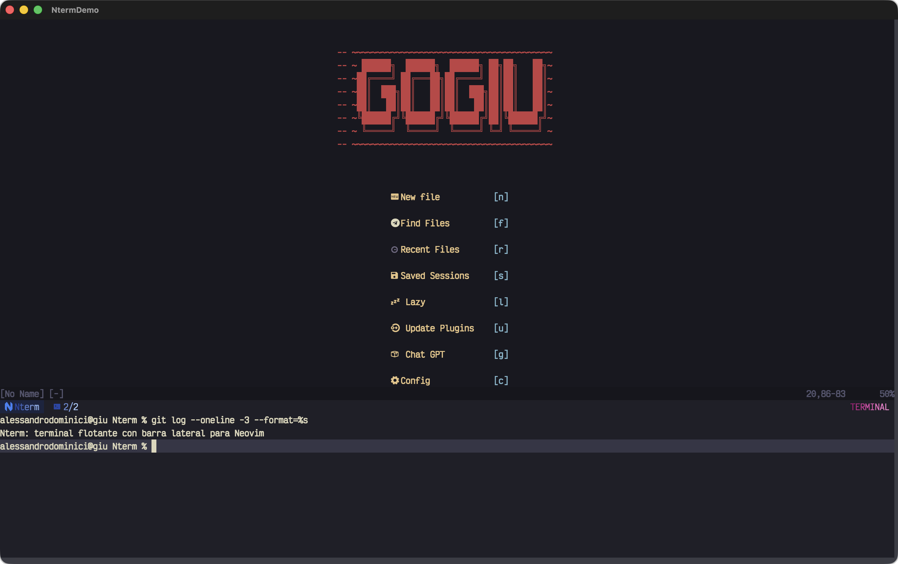
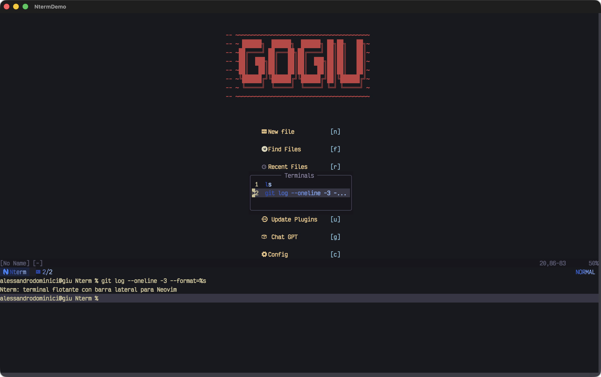

# Nterm

Floating terminal for Neovim, with a sidebar to switch between several terminals.



## Features

- Floating terminal toggled with `Ctrl-/`.
- Sidebar listing every open terminal with its last command, selectable by number.
- Create terminals and switch between them without opening the sidebar.
- Header with the current terminal (e.g. `2/3`), a gradient title, the current mode (NORMAL, INSERT, VISUAL, TERMINAL…) in its own gradient, and a guide of essential keymaps.
- Floating by default, or docked to the bottom, left or right of the editor.
- `Ctrl-q` popup with every keymap, and a full guide in `:help nterm`.

## Screenshots

| Sidebar | Keymaps (`Ctrl-q`) | Confirmation before closing |
|---|---|---|
|  |  |  |

| Docked at the bottom | Docked, with the floating sidebar |
|---|---|
|  |  |

## Requirements

- Neovim 0.11 or newer.
- A [Nerd Font](https://www.nerdfonts.com/) for the header icon.

## Installation

No need to call `setup()`: the plugin activates itself when Neovim starts.

### lazy.nvim

```lua
{ 'Gogiu23/Nterm' }
```

### vim.pack (Neovim 0.12+)

```lua
vim.pack.add({ 'https://github.com/Gogiu23/Nterm' })
```

### packer.nvim

```lua
use 'Gogiu23/Nterm'
```

### Without a plugin manager

```sh
git clone https://github.com/Gogiu23/Nterm \
  ~/.local/share/nvim/site/pack/plugins/start/nterm
```

Restart Neovim and press `Ctrl-/`. To check it's loaded, `:lua print(vim.g.loaded_nterm)` should print `true`.

## Configuration

Nterm works without calling `setup()`. To change the defaults:

```lua
require('nterm').setup({
  position = 'float', -- 'float', 'bottom', 'left' or 'right'
  size = 0.3,         -- docked positions: fraction of the editor
})
```

With lazy.nvim:

```lua
{ 'Gogiu23/Nterm', opts = { position = 'bottom' } }
```

With `bottom`, `left` or `right` the terminal is a split docked to that side of the editor. The header and the guide are replaced by a single tab with the title, the current terminal and the mode, and the sidebar opens as a floating window.

## Usage

| Where | Key | Action |
|---|---|---|
| Anywhere | `Ctrl-/` | Show or hide the terminal (creates one if none exists) |
| Terminal | `Ctrl-+` | Open a new terminal |
| Terminal | `Ctrl->` / `Ctrl-<` | Next / previous terminal (wraps around) |
| Terminal | `Ctrl-b` | Open the sidebar |
| Terminal | `Ctrl-q` | Show every keymap |
| Terminal | `Esc Esc` | Switch to normal mode |
| Sidebar | `1`–`9` / `Enter` | Switch to that terminal and close the sidebar |
| Sidebar | `Ctrl-+` | Open a new terminal and close the sidebar |
| Sidebar | `Ctrl-d` | Close the selected terminal (asks first) |
| Sidebar | `Ctrl-b` / `q` / `Esc` | Close the sidebar and go back to the terminal |
| Sidebar | `Ctrl-q` | Show every keymap |

## Guide

Inside Neovim:

```vim
:NtermHelp
```

or the standard `:help nterm`.

## Notes

- `Ctrl-+`, `Ctrl->` and `Ctrl-<` only reach Neovim in terminals that support the kitty keyboard protocol (Kitty, WezTerm, Ghostty, Alacritty). Elsewhere use `Ctrl-=` (new), `Ctrl-.` (next) and `Ctrl-,` (previous).
- Inside Nterm, `Ctrl-b`, `Ctrl-q`, `Ctrl-.` and `Ctrl-,` are taken by Nterm and don't reach the shell (e.g. a tmux prefix or readline's backward-char).
- Many terminals send `Ctrl-/` as `Ctrl-_`; Nterm maps both.
- The last command is read from the prompt line when you press Enter, stripping the prompt up to the first `$ > # % ❯`. With unusual prompts the whole line may be shown.

## Development

```sh
# headless tests
nvim --headless -u NONE --cmd 'set rtp+=.' -l tests/smoke.lua
nvim --headless -u NONE --cmd 'set rtp+=.' -l tests/docked.lua

# regenerate the screenshots in a new Alacritty window (macOS; the terminal
# running it needs Screen Recording permission)
assets/capture/run.sh
```
