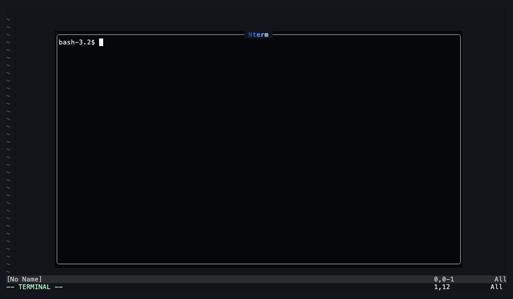

# Nterm

Floating terminal for Neovim, with a sidebar to switch between several terminals.



## Features

- Floating terminal toggled with `Ctrl-/`.
- Sidebar listing every open terminal with its last command, selectable by number.
- Create terminals and switch between them without opening the sidebar.
- Header with the current terminal (e.g. `2/3`), a gradient title, the current mode (NORMAL, INSERT, VISUAL, TERMINAL…) in its own gradient, and a guide of essential keymaps.
- Floating by default, or docked to the bottom, left or right of the editor.
- [Lazygit](https://github.com/jesseduffield/lazygit) integration (`<leader>gg`), and `:Nterm <cmd>` to run any program in a terminal.
- `Ctrl-q` popup with every keymap, and a full guide in `:help nterm`.

## Screenshots


| Sidebar | Keymaps (`Ctrl-q`) | Confirmation before closing |
|---|---|---|
|  |  |  |

| Docked at the bottom | Docked, with the floating sidebar |
|---|---|
|  |  |

## Requirements

- Neovim 0.11 or newer.
- A [Nerd Font](https://www.nerdfonts.com/) for the header icon.

## Installation

No need to call `setup()`: the plugin activates itself when Neovim starts.

### lazy.nvim

```lua
{ 'Gogiu23/Nterm' }
```

### vim.pack (Neovim 0.12+)

```lua
vim.pack.add({ 'https://github.com/Gogiu23/Nterm' })
```

### packer.nvim

```lua
use 'Gogiu23/Nterm'
```

### Without a plugin manager

```sh
git clone https://github.com/Gogiu23/Nterm \
  ~/.local/share/nvim/site/pack/plugins/start/nterm
```

Restart Neovim and press `Ctrl-/`. To check it's loaded, `:lua print(vim.g.loaded_nterm)` should print `true`.

## Configuration

Nterm works without calling `setup()`. To change the defaults:

```lua
require('nterm').setup({
  position = 'float',  -- 'float', 'bottom', 'left' or 'right'
  size = 0.3,          -- docked positions: fraction of the editor
  theme = 'auto',      -- 'auto': colors from your colorscheme, 'nterm': built-in palette
  opacity = 1,         -- floating windows, 0..1 (uses 'winblend')
  transparent = false, -- no background: your terminal emulator's transparency shows
  lazygit_key = '<leader>gg', -- false to disable
  border_color = '#2391FF',   -- or { '#from', '#to' }
})
```

With lazy.nvim:

```lua
{ 'Gogiu23/Nterm', opts = { position = 'bottom' } }
```

With `bottom`, `left` or `right` the terminal is a split docked to that side of the editor. The header and the guide are replaced by a single tab with the title, the current terminal and the mode, and the sidebar opens as a floating window.

**Colors.** With `theme = 'auto'` (the default) the gradients are built from your colorscheme's highlight groups (`Function` for the title and NORMAL, `String` for INSERT, `Type` for VISUAL, `Keyword` for TERMINAL, `Number` for COMMAND, `DiagnosticError` for REPLACE) and follow it when you switch colorscheme. `theme = 'nterm'` uses the built-in blue palette.

**Border.** The borders of the floating windows are a gradient from the top-left corner (darkest) to the bottom-right one (lightest). `border_color` takes one color, whose dark and light shades are used, or a `{ from, to }` pair with the exact ends. Default: `#2391FF`.

**Opacity and transparency.** `opacity` makes the floating windows see-through (Neovim's `winblend`; it doesn't apply to docked splits). `transparent = true` removes Nterm's background instead, so your terminal emulator's own transparency (e.g. Alacritty's `window.opacity`) shows through.

## Usage

| Where | Key | Action |
|---|---|---|
| Anywhere | `Ctrl-/` | Show or hide the terminal (creates one if none exists) |
| Anywhere | `<leader>gg` | Open lazygit |
| Terminal | `Ctrl-+` | Open a new terminal |
| Terminal | `Ctrl->` / `Ctrl-<` | Next / previous terminal (wraps around) |
| Terminal | `Ctrl-b` | Open the sidebar |
| Terminal | `Ctrl-q` | Show every keymap |
| Terminal | `Esc Esc` | Switch to normal mode |
| Sidebar | `1`–`9` / `Enter` | Switch to that terminal and close the sidebar |
| Sidebar | `Ctrl-+` | Open a new terminal and close the sidebar |
| Sidebar | `Ctrl-d` | Close the selected terminal (asks first) |
| Sidebar | `Ctrl-b` / `q` / `Esc` | Close the sidebar and go back to the terminal |
| Sidebar | `Ctrl-q` | Show every keymap |

## Lazygit

`<leader>gg` (or `:Nterm lazygit`) opens lazygit in a Nterm terminal at the git root of the current file, or switches to it if it's already running. Every key except `Ctrl-/` (hide) and `Ctrl-<` / `Ctrl->` (switch terminals) goes to lazygit, so `Esc`, `Ctrl-b`, `Ctrl-d`… work as usual. Quitting lazygit closes its terminal.

To open files from lazygit (`e`) in this Neovim instead of a nested one, add this to lazygit's `config.yml` (find it with `lazygit --print-config-dir`):

```yaml
os:
  editPreset: nvim-remote
  edit: >-
    [ -z "$NVIM" ] && (nvim -- {{filename}}) ||
    nvim --server "$NVIM" --remote-send '<C-\><C-n><Cmd>lua require("nterm").edit([[{{filename}}]])<CR>'
  editAtLine: >-
    [ -z "$NVIM" ] && (nvim +{{line}} -- {{filename}}) ||
    nvim --server "$NVIM" --remote-send '<C-\><C-n><Cmd>lua require("nterm").edit([[{{filename}}]], {{line}})<CR>'
  openDirInEditor: >-
    [ -z "$NVIM" ] && (nvim -- {{dir}}) ||
    nvim --server "$NVIM" --remote-send '<C-\><C-n><Cmd>lua require("nterm").edit([[{{dir}}]])<CR>'
```

Editing a file hides Nterm and keeps lazygit running, so `Ctrl-/` brings it back where you left it. Outside Neovim the commands fall back to plain `nvim`.

`:Nterm <cmd>` works the same way for any other program, e.g. `:Nterm btop`.

## Guide

Inside Neovim:

```vim
:NtermHelp
```

or the standard `:help nterm`.

## Notes

- `Ctrl-+`, `Ctrl->` and `Ctrl-<` only reach Neovim in terminals that support the kitty keyboard protocol (Kitty, WezTerm, Ghostty, Alacritty). Elsewhere use `Ctrl-=` (new), `Ctrl-.` (next) and `Ctrl-,` (previous).
- Inside Nterm, `Ctrl-b`, `Ctrl-q`, `Ctrl-.` and `Ctrl-,` are taken by Nterm and don't reach the shell (e.g. a tmux prefix or readline's backward-char).
- Many terminals send `Ctrl-/` as `Ctrl-_`; Nterm maps both.
- The last command is read from the prompt line when you press Enter, stripping the prompt up to the first `$ > # % ❯`. With unusual prompts the whole line may be shown.

## Development

```sh
# headless tests
nvim --headless -u NONE --cmd 'set rtp+=.' -l tests/smoke.lua
nvim --headless -u NONE --cmd 'set rtp+=.' -l tests/docked.lua
nvim --headless -u NONE --cmd 'set rtp+=.' -l tests/theme.lua
nvim --headless -u NONE --cmd 'set rtp+=.' -l tests/lazygit.lua

# regenerate the screenshots and assets/demo.gif in a new Alacritty window
# (macOS, needs ffmpeg; the terminal running it needs Screen Recording permission)
assets/capture/run.sh
```
